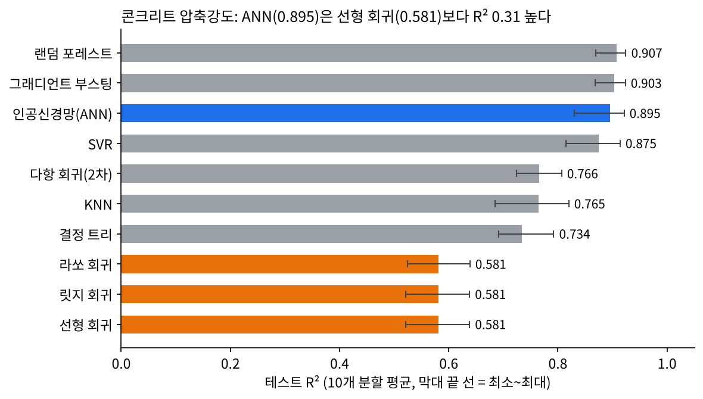

# 콘크리트 압축강도 예측: 회귀 분석과 인공신경망 비교

공개 데이터인 **UCI 콘크리트 압축강도**(1,030개 배합)를 이용해, 콘크리트 배합 정보로 압축강도(MPa)를 예측하는 프로그램입니다. 선형·비선형 회귀(과제 1)와 인공신경망(과제 2)을 같은 데이터·같은 평가 방법으로 비교할 수 있는 Streamlit 웹 대시보드로 만들었습니다.

| 과제 | 내용 | 설명서 |
| --- | --- | --- |
| 과제 1 | 공개 자료로 선형회귀·비선형회귀를 수행하는 프로그램 | [Notion 설명서](https://www.notion.so/3e8361e0fce780ca92f9c0e32fbaffdb) |
| 과제 2 | 공개 자료로 인공신경망을 이용한 데이터 예측 프로그램 | [Notion 설명서](https://www.notion.so/630361e0fce78206b1f3813ff1f691fa) |

- 웹에서 바로 실행: https://2flnfab8wrd8cdseatvmj4.streamlit.app
- 과제 모음 페이지: [데이터처리개론 과제 (Notion)](https://www.notion.so/3f9361e0fce781609556d7190fe57ba1)

## 한눈에 보는 결과



- 인공신경망(은닉층 64-32)의 테스트 R²는 **0.895**(10회 분할 평균)로, 선형 회귀(0.581)보다 0.31 높았습니다.
- 평균 오차(MAE)는 인공신경망 3.98 MPa, 선형 회귀 7.75 MPa입니다.
- 데이터가 적거나(20행 이하) 관계가 단순한 데이터에서는 인공신경망이 학습 데이터를 외워버려 선형 회귀보다 나빴습니다. 자세한 분석은 Notion 설명서에 있습니다.

## 주요 기능

| 화면 탭 | 기능 |
| --- | --- |
| 📋 데이터 탐색 | 미리보기, 기술 통계, 결측치, 상관계수 히트맵, 분포·산점도 |
| 📊 성능 비교 | 테스트·교차검증·학습 R², RMSE, MAE, MAPE, 과적합 격차, 적합 곡선, 3D 예측 곡면 |
| 📉 잔차 진단 | 잔차 산점도·히스토그램, Q-Q 플롯, Shapiro-Wilk 정규성 검정, Durbin-Watson |
| 🔍 모델 해석 | 회귀 계수와 p값, 순열 변수 중요도, 부분 의존도, 인공신경망 학습 곡선 |
| 🔮 예측 | 새 배합 값을 넣으면 모든 모델의 예측을 동시에 표시, 파일 일괄 예측 |
| 💾 내보내기 | 평가지표·예측값 CSV, 학습된 모델 파일 |

CSV나 Excel 파일을 올리면 다른 데이터로도 같은 분석을 할 수 있습니다.

## 사용한 알고리즘

| 구분 | 모델 |
| --- | --- |
| 선형 회귀 (과제 1) | 최소제곱 선형 회귀, 릿지, 라쏘 |
| 비선형 회귀 (과제 1) | 다항 회귀(2~6차), 거듭제곱 y = a·x^b, 지수 y = a·e^(bx), 로그 y = a + b·ln x |
| 인공신경망 (과제 2) | 다층 퍼셉트론(MLP): 은닉층 1~3개, ReLU/tanh/sigmoid, Adam 최적화, L2 규제 |
| 비교용 머신러닝 | 결정 트리, 랜덤 포레스트, 그래디언트 부스팅, SVR, KNN |

모든 모델은 학습 데이터(80%)로만 학습하고, 학습에 쓰지 않은 테스트 데이터(20%)와 5-겹 교차검증으로 평가합니다.

## 실행 방법

Python 3.10 이상이 필요합니다.

```bash
git clone https://github.com/csw33400-art/-2.git
cd -2
pip install -r requirements.txt
streamlit run app.py
```

브라우저가 열리면 왼쪽 사이드바에서 데이터, 변수, 모델을 고르면 됩니다. 기본 데이터는 콘크리트 압축강도입니다.

## 폴더 구조

```
.
├── app.py                 # Streamlit 대시보드 (프로그램 본체)
├── requirements.txt       # 필요한 패키지
├── data/
│   ├── concrete.csv       # UCI 콘크리트 압축강도 공개 데이터 (1,030행)
│   └── README.md          # 데이터 출처·라이선스·변수 설명
└── docs/
    ├── experiments.py     # 설명서의 모델 비교 실험
    ├── ann_and_figs.py    # 인공신경망 구조 실험과 그래프 생성
    ├── results.json       # 실험 결과 수치
    └── figures/           # 설명서에 쓴 그래프
```

## 실험 재현

설명서의 수치와 그래프는 아래 명령으로 다시 만들 수 있습니다. 그래프에는 `matplotlib`이 추가로 필요합니다.

```bash
python docs/experiments.py data/concrete.csv docs/results.json
python docs/ann_and_figs.py data/concrete.csv docs/results.json docs/figures
```

## 데이터 출처

- Yeh, I-C. (1998). *Concrete Compressive Strength* [Dataset]. UCI Machine Learning Repository. https://doi.org/10.24432/C5PK67 (CC BY 4.0)
- Yeh, I-C. (1998). Modeling of strength of high-performance concrete using artificial neural networks. *Cement and Concrete Research*, 28(12), 1797–1808.
- 비교용 데이터: scikit-learn 내장 당뇨병 진행도 데이터 (Efron et al., 2004)
