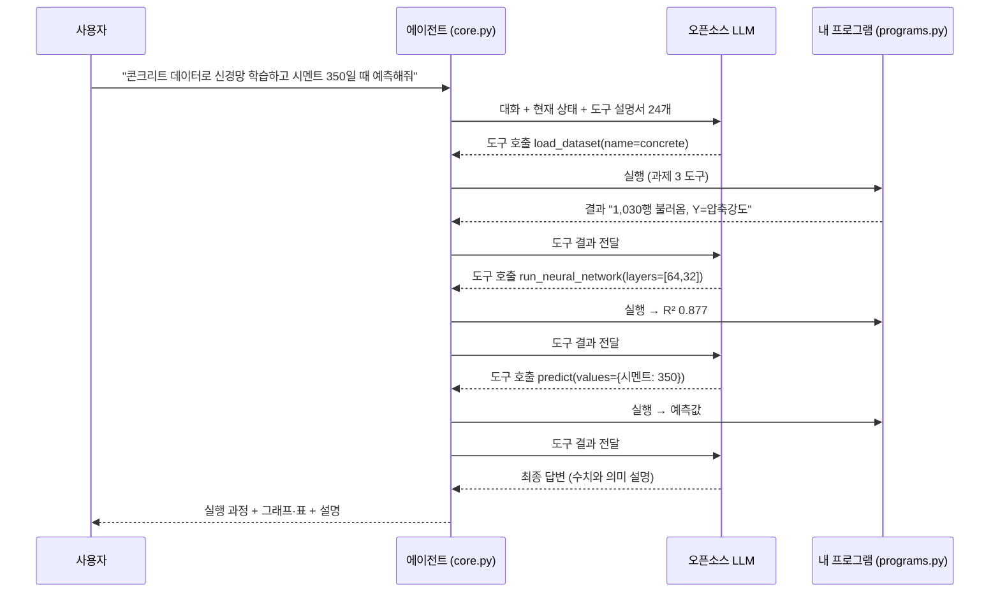
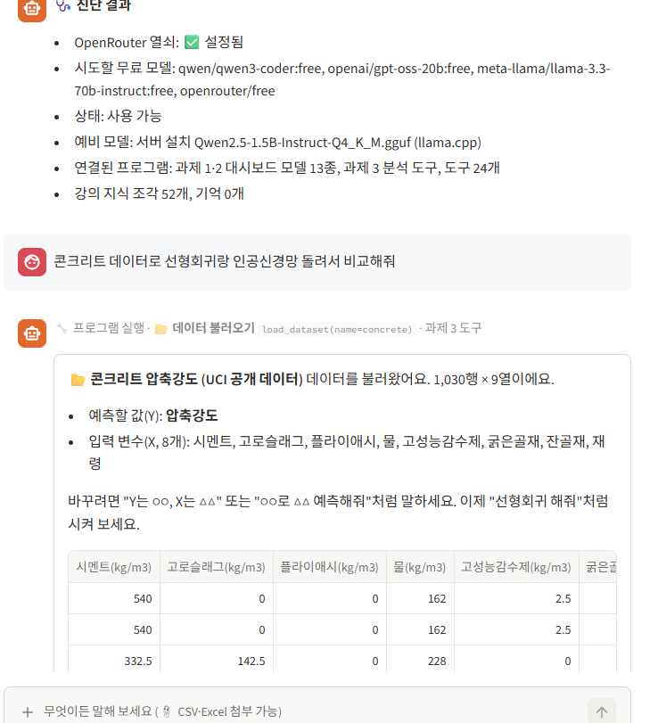
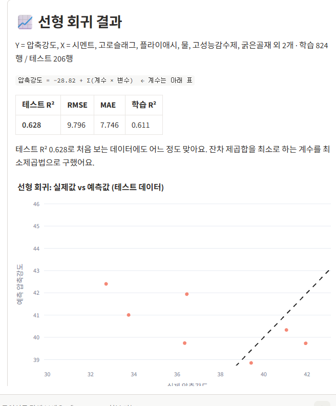
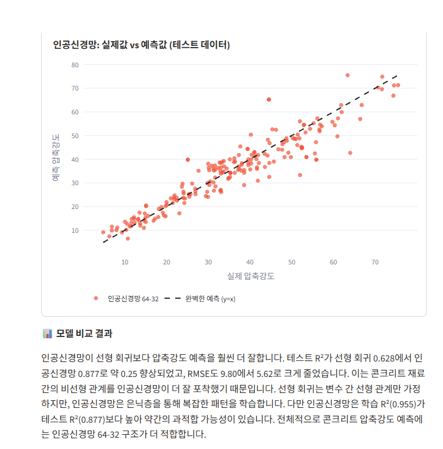

# 프로그램 설명서: LLM 기반 자동 데이터분석 시스템

데이터처리개론 마지막 과제의 설명서입니다. 과제 1·2·3의 프로그램과 설명서는 그대로 두고, 이 시스템은 `agent/` 폴더에 따로 만들었습니다.

| 항목 | 내용 |
| --- | --- |
| 과제 | 오픈소스 LLM을 이용해 지금까지 본인이 만든 프로그램들을 대화를 통해 운용할 수 있는 프로그램 |
| 운용 대상 | 과제 1·2 회귀·인공신경망 대시보드(`app.py`), 과제 3 채팅 분석 도구(`llm_chat/tools.py`) |
| LLM | OpenRouter 무료 오픈소스 모델(NVIDIA Nemotron 3.5 Super VL 120B, Qwen3-Coder, gpt-oss-20b, Llama 3.3 70B 순서), 서버 설치 Qwen2.5-1.5B(예비) |
| 핵심 기술 | 도구 호출(Function Calling), 명령→실행→결과 회신 반복(에이전트 루프), 강의 RAG, 메모 기억 |
| 비용 | 0원 (무료 모델만 사용) |

## 1. 과제 3과 무엇이 다른가

| 구분 | 과제 3 챗봇 | 마지막 과제 |
| --- | --- | --- |
| 말을 알아듣는 주체 | 프로그램의 낱말 규칙 ("선형회귀"라는 낱말을 보면 실행) | **LLM이 직접 판단** |
| LLM의 역할 | 결과 해설, 개념 질문 답변 | **실행할 도구와 값을 고르고, 결과를 받아 다음 행동을 정함** |
| 여러 단계 요청 | 한 번에 한 가지 | "불러와서 → 변수 정하고 → 학습하고 → 예측" 연속 실행 |
| 운용하는 프로그램 | 챗봇 안의 분석 함수 | 과제 1·2 대시보드 모델 13종 + 과제 3 분석 도구 |
| 지식 | 주제별 메모 20개 | 강의 장별 정리 32조각 + 메모 20개를 TF-IDF로 검색(RAG), 내 코드 검색 |

## 2. 동작 원리: 명령 → 실행 → 결과 회신

교수님이 수업에서 말한 "로봇에게 앞으로 가라고 시키면, 앞으로 갔다는 신호가 다시 와야 한다"는 구조입니다. LLM은 도구 결과를 받아야 다음 도구를 고를 수 있고, 결과에 나온 숫자로만 설명합니다. 한 번의 대화에서 LLM은 최대 5번 불립니다.

## 3. 운용하는 프로그램과 도구 24개

### 과제 1·2 대시보드 (`app.py`)

`run_dashboard_models` 도구는 대시보드 파일을 문법 트리(AST)로 읽어서 모델을 만드는 코드(`build_estimator`, `CurveFitRegressor`, `safe_metrics`)만 골라 실행합니다. 대시보드 파일은 고치지 않고, 대시보드와 똑같은 13개 모델과 사이드바 기본값을 씁니다.

선형, 릿지, 라쏘, 다항, 결정 트리, 랜덤 포레스트, 그래디언트 부스팅, SVR, KNN, 인공신경망, 거듭제곱·지수·로그 회귀(X가 1개일 때)

### 과제 3 분석 도구 (`llm_chat/tools.py`)

| 분류 | 도구 |
| --- | --- |
| 데이터 | `list_datasets`, `load_dataset`(공개 데이터 9종), `load_data_url`, `make_data`(식으로 만들기), `data_summary`, 파일 첨부 |
| 변수 | `set_variables`(Y·X·제외), `add_variable`(식으로 새 변수) |
| 회귀 | `run_linear_regression`, `run_nonlinear_regression`(차수 지정 가능) |
| 신경망 | `run_neural_network`(은닉층·활성화 함수·에포크·학습률 지정), `run_deep_learning`(128-64-32-16, 조기 종료) |
| 비교·예측 | `compare_models`, `predict`(값 여러 개, 직전 입력 유지), `sweep_variable`(변화 곡선) |
| 시각화·통계 | `correlation`, `plot`(산점도·히스토그램), `column_stats` |
| 정리 | `make_report`, `current_status` |

### 지식과 기억

| 도구 | 하는 일 |
| --- | --- |
| `search_lecture` | 강의 2~8장과 LLM 수업 내용을 정리한 조각에서 질문과 비슷한 것을 찾아 LLM에게 근거로 건넴 (RAG) |
| `search_my_code` | 내 프로그램 파일을 함수 단위로 잘라 둔 조각에서 관련 코드를 찾아 보여 줌 |
| `remember`, `recall_memory` | 사용자가 기억해 달라고 한 내용과 실행 기록을 메모 파일에 적고 읽음 |

## 4. 사용 예시

| 말 | LLM이 고르는 도구 (예) |
| --- | --- |
| "콘크리트 데이터로 선형회귀랑 인공신경망 돌려서 비교해줘" | `load_dataset` → `run_linear_regression` → `run_neural_network` → 설명 |
| "대시보드 모델 전부 학습시키고 제일 좋은 모델 알려줘" | `run_dashboard_models` |
| "시멘트 350, 물 170, 재령 28일 때 강도 예측해줘" | `predict` |
| "물을 200으로 바꾸면?" | `predict(keep_previous=true)` |
| "물이 늘어나면 강도가 어떻게 변해?" | `sweep_variable(variable=물)` |
| "은닉층 3개로 tanh 써서 다시 학습해줘" | `run_neural_network(layers=[64,32,16], activation=tanh)` |
| "역전파가 뭐야? 내 코드 어디에 있어?" | `search_lecture` → `search_my_code` → 설명 |
| "자동차 연비 데이터로 마력이랑 무게로 연비 예측 모델 만들어줘" | `load_dataset(mpg)` → `set_variables` → 학습 도구 |
| "오늘 결론 기억해 둬" / "지난번에 뭐 했지?" | `remember` / `recall_memory` |

## 5. 실행 결과 (콘크리트 압축강도, 입력 변수 8개)

"대시보드 모델 전부 학습시켜줘"로 실행한 결과입니다. 학습 824행, 테스트 206행, 5겹 교차검증.

| 모델 | 테스트 R² | RMSE | 5겹 CV R² | 과적합 격차 |
| --- | --- | --- | --- | --- |
| 그래디언트 부스팅 | **0.888** | 5.37 | 0.892 | 0.061 |
| 랜덤 포레스트 | 0.881 | 5.53 | 0.900 | 0.105 |
| 인공신경망 (64-32) | 0.877 | 5.62 | 0.898 | 0.078 |
| SVR | 0.870 | 5.80 | 0.867 | 0.076 |
| 다항 회귀 | 0.784 | 7.46 | 0.777 | 0.029 |
| KNN | 0.777 | 7.59 | 0.751 | 0.221 |
| 결정 트리 | 0.639 | 9.65 | 0.749 | 0.179 |
| 선형 회귀 | 0.628 | 9.80 | 0.602 | −0.017 |

이어서 "시멘트 350, 물 170, 재령 28일 때 예측해줘"는 가장 정확한 그래디언트 부스팅 기준 53.9 MPa, "물을 200으로 바꾸면?"은 41.4 MPa였습니다. 물이 많을수록 강도가 낮아지는 콘크리트의 성질과 같은 방향입니다.

- 선형 회귀(0.628)보다 비선형 모델들이 0.25 이상 높습니다. 강의 3장에서 배운 선형회귀의 한계(비선형성·다차원성)가 드러납니다.
- KNN과 결정 트리는 학습 R²와 테스트 R²의 차이가 커서 과적합 기미가 있습니다(강의 7장).

## 6. LLM 선택과 예비 구조

| 순서 | 방식 | 이유 |
| --- | --- | --- |
| 1 | OpenRouter 무료 오픈소스 모델 + 도구 호출 | 도구를 고르는 판단에는 큰 모델이 필요. 교수님이 수업에서 인정한 방식(Streamlit + OpenRouter) |
| 2 | 같은 모델에게 글로 도구를 고르게 함 | 일부 무료 모델은 도구 호출 기능을 지원하지 않음 |
| 3 | 서버 설치 Qwen2.5-1.5B + 낱말 규칙 | 열쇠가 없거나 무료 한도(하루 50회)를 다 썼을 때도 사이트가 멈추지 않게 |

- 무료 사용 한도: 하루 50회, 분당 20회(OpenRouter 문서 기준). 한 번 말하면 LLM이 2~4회 불리므로 하루 15~25번 대화할 수 있습니다.
- 응답하지 않은 무료 모델은 다음부터 뒤로 미뤄서 횟수를 아낍니다.
- 15억 매개변수 모델은 도구 선택을 자주 틀려서, 예비 모드에서는 낱말 규칙이 도구를 고르고 모델은 결과 설명만 합니다.

## 7. 실제 배포 후 테스트 (2026-11-27)

웹 주소: https://csw33400-art--2-agentapp-meutiy.streamlit.app/

입력: "콘크리트 데이터로 선형회귀랑 인공신경망 돌려서 비교해줘" → 응답 모델: OpenRouter `nvidia/nemotron-3.5-super-vl:free`

| 순서 | LLM이 고른 도구 | 결과 |
| --- | --- | --- |
| 1 | `load_dataset(name=concrete)` | 1,030행 × 9열 불러옴 |
| 2 | `run_linear_regression()` | 테스트 R² 0.628, RMSE 9.80 |
| 3 | `run_neural_network()` | 테스트 R² 0.877, RMSE 5.62, 학습 R² 0.955 |
| 4 | (최종 답변) | 두 결과를 비교 설명. 수치는 도구 결과와 일치 |

LLM의 최종 설명(요약): 인공신경망이 테스트 R²를 0.628에서 0.877로 약 0.25 높이고 RMSE를 9.80에서 5.62로 줄였으며, 은닉층이 재료 간 비선형 관계를 포착했기 때문이다. 다만 학습 R²(0.955)가 테스트 R²보다 높아 약간의 과적합 가능성이 있다.

**결론**: 사용자는 한 문장만 말했고, LLM이 필요한 도구 세 개를 순서대로 골라 실행한 뒤 결과 수치를 근거로 설명했다. 명령 → 실행 → 결과 회신 구조가 실제 무료 오픈소스 모델에서 동작함을 확인했다. 처음 지정한 무료 모델 일부는 응답하지 않아 `openrouter/free`가 Nemotron을 골랐고, 이후 Nemotron을 1순위로 바꿨다.

## 8. 한계와 개선 방향

- **무료 모델의 변동**: 무료 모델 목록과 성능이 수시로 바뀌고 혼잡하면 느립니다. 유료 크레딧이나 자체 GPU 서버가 있으면 더 크고 안정적인 모델을 쓸 수 있습니다.
- **Streamlit의 한계**: 학생 프로젝트용으로 간단하지만 접속자가 많으면 버티지 못합니다(LLM 수업 내용). 실서비스라면 별도 웹 서버가 필요합니다.
- **기억의 범위**: 메모 파일은 서버가 재시작되면 지워지고, 모든 접속자가 같은 메모를 봅니다. 데이터베이스에 사용자별로 저장하면 해결됩니다.
- **RAG 자료**: 강의 슬라이드가 대부분 그림이라 글자를 그대로 쓸 수 없어서, 장별 핵심을 직접 정리한 조각을 썼습니다.
- **확인 범위**: 개발 중에는 테스트 서버와 가짜 모델로 시험했고, 배포 후 실제 무료 모델(Nemotron 3.5 Super VL)로 여러 단계 운용을 확인했습니다(7절). 무료 모델은 바뀔 수 있어 다른 모델이 걸리면 판단 품질이 달라질 수 있습니다.
