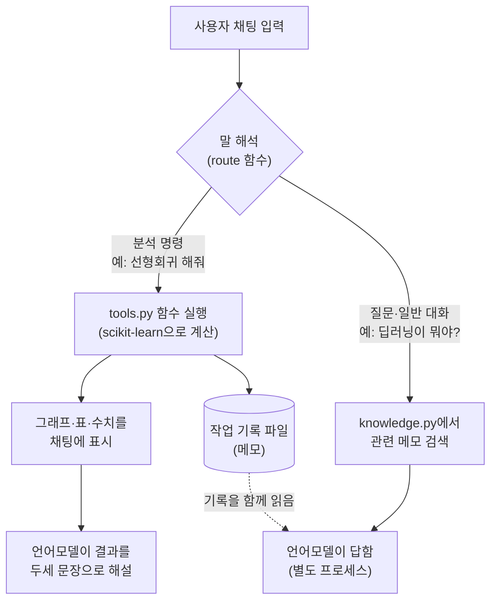

# 프로그램 설명서: 오픈소스 LLM 챗봇

데이터처리개론 과제 3 (오픈소스 LLM을 설치하고 대화가 되는지 테스트한 프로그램)의 설명서입니다. 과제 1(선형·비선형 회귀)과 과제 2(인공신경망)의 프로그램과 설명서는 그대로 두고, 이 챗봇은 `llm_chat/` 폴더에 따로 만들었습니다.

| 항목 | 내용 |
| --- | --- |
| 과제 | Opensource LLM을 하나 선택하여 설치하고 간단한 대화가 가능한지 테스트한 후 프로그램으로 제출 |
| 선택한 LLM | Qwen2.5-1.5B-Instruct (Alibaba, Apache 2.0), 4비트 양자화 GGUF |
| 설치 위치 | 웹 서버 (Streamlit Community Cloud). 사용자는 설치 없이 웹 주소로 접속 |
| 사용 방법 | 채팅창 하나. 버튼·메뉴 없이 말로만 사용 |
| 코드 | [`llm_chat/`](..) · 코드 설명은 [CODE.md](CODE.md) |

## 1. 무엇을 하는 프로그램인가

1. **자유 대화**: ChatGPT처럼 아무 질문이나 하면 서버에 설치한 오픈소스 언어모델이 답합니다.
2. **채팅으로 분석 실행**: "선형회귀 해줘", "인공신경망 학습해줘"라고 말하면 실제로 계산해서 그래프·표·해석을 채팅 안에 보여 줍니다.
3. **어떤 데이터든 사용**: 공개 데이터 9종, 파일 첨부, 데이터 주소, 붙여넣은 표, 직접 적은 숫자, 식으로 만든 데이터를 모두 씁니다.
4. **입력값에 따른 예측**: "시멘트 350 물 170이면?"처럼 값을 말하면 학습한 모델로 그때그때 계산합니다.
5. **기억**: 한 일을 메모로 적어 두고 "지난번에 뭐 했지?"에 답합니다.

## 2. 오픈소스 LLM 선정과 설치

### 2.1 서버 사양에 맞춘 선택

수업에서 "컴퓨터 사양에 맞는 모델을 골라야 한다"고 배웠습니다. 서버는 GPU가 없고 CPU 2코어, 메모리 약 2.7GB입니다.

| 후보 | 매개변수 | 4비트 파일 크기 | 이 서버에서 | 판단 |
| --- | --- | --- | --- | --- |
| DeepSeek 원본 (수업에서 언급) | 약 6,710억 개 | 수백 GB | 실행 불가 | 제외 |
| 7~8B급 모델 | 약 70~80억 개 | 약 5GB | 메모리 초과 | 제외 |
| **Qwen2.5-1.5B-Instruct** | 약 15억 개 | 약 0.99GB | 실행 가능 | **기본 모델** |
| EXAONE-3.5-2.4B-Instruct (LG AI연구원) | 약 24억 개 | 약 1.64GB | 실행 가능하지만 느림 | 한국어 비교용 ("엑사원으로 바꿔줘") |

### 2.2 설치 과정

| 단계 | 사용한 것 | 하는 일 |
| --- | --- | --- |
| 실행 도구 설치 | `llama-cpp-python` (llama.cpp의 파이썬 버전) | GGUF 모델을 CPU로 실행. `requirements.txt`에 적어 서버가 설치 |
| 모델 내려받기 | Hugging Face 모델 저장소 | 처음 대화할 때 모델 파일(약 1GB)을 서버에 내려받음 |
| 모델 불러오기 | `Llama.from_pretrained(...)` | 파일을 메모리에 올림. 문맥 4,096토큰 |
| 대화 | `create_chat_completion(stream=True)` | 답을 한 토큰씩 만들어 화면에 흘려보냄 |

가중치 15억 개를 16비트로 저장하면 약 3GB라 서버 메모리에 들어가지 않습니다. 그래서 4비트로 줄인 파일(양자화, Q4_K_M)을 썼습니다.

## 3. 사용법 (채팅 예시)

| 하고 싶은 것 | 채팅에 이렇게 입력 |
| --- | --- |
| 자유 대화 | "딥러닝이 뭐야?", "선형회귀랑 인공신경망은 뭐가 달라?", "오픈소스 LLM의 장단점은?" |
| 공개 데이터 | "데이터 목록 보여줘", "콘크리트 데이터 불러와", "자동차 연비 데이터 불러와" |
| 내 데이터 | 입력창 📎로 파일 첨부(CSV·Excel·TSV·TXT·JSON), 데이터 주소 붙여넣기, 표를 그대로 붙여넣기 |
| 숫자 직접 입력 | "x: 1, 2, 3, 4, 5 / y: 2.1, 3.9, 6.2, 8.1, 9.8 선형회귀 해줘" |
| 데이터 만들기 | "y = 2x + 3 데이터 만들어서 선형회귀 해줘" |
| 데이터 살펴보기 | "데이터 요약 보여줘", "열 목록 보여줘", "상관관계 보여줘", "시멘트 평균 알려줘", "물이랑 강도 산점도 그려줘" |
| 변수 정하기 | "Y는 압축강도, X는 시멘트랑 재령", "마력으로 연비 예측해줘", "물 빼고 해줘", "모든 변수로 해줘" |
| 선형회귀 | "선형회귀 해줘" |
| 비선형회귀 | "비선형회귀 해줘", "3차 다항 회귀 해줘" |
| 인공신경망 | "인공신경망 학습해줘", "은닉층 32-16, tanh, 에포크 500으로 신경망 학습해줘" |
| 딥러닝 | "딥러닝으로 해줘" |
| 모델 비교·보고서 | "전부 비교해줘", "보고서 만들어줘" |
| 예측 | "시멘트 350 물 170이면?", "물을 200으로 바꾸면?", "재령 7, 28, 90일 때 각각 예측해줘" |
| 변화 보기 | "시멘트를 100에서 500까지 바꾸면?", "물이 늘어나면 강도는?" |
| 새 변수 | "물시멘트비 = 물 / 시멘트 변수 만들어줘" |
| 기억 | "지난번에 뭐 했지?", "기억 지워줘" |
| 설정·점검 | "엑사원으로 바꿔줘", "모델 정보 알려줘", "서버 사양 알려줘", "진단", "도움말" |

## 4. 동작 원리

- **계산은 프로그램이, 말은 언어모델이** 맡습니다. 15억 매개변수짜리 작은 모델에게 숫자 계산까지 맡기면 없는 숫자를 지어낼 수 있어서(환각), 회귀와 신경망 계산은 scikit-learn이 합니다.
- **질문과 명령을 구분**합니다. "인공신경망은 어떻게 학습해?"는 설명을, "인공신경망 학습해줘"는 실제 학습을 실행합니다.
- **참고 메모 검색(RAG)**: 주제별 메모 20개 중 질문과 관련된 것을 찾아 질문과 함께 모델에 넣어 줍니다. 가중치를 바꾸는 파인튜닝이 아니라, 수업에서 배운 "적어 놓고 다시 읽는" 방식입니다.
- **언어모델은 별도 프로세스**에서 돕니다. 모델이 메모리 부족으로 멈춰도 채팅 화면과 분석 기능은 계속 동작합니다.

## 5. 분석 방법과 실행 결과

모든 분석은 데이터의 80%로 학습하고 학습에 쓰지 않은 20%(테스트)로 평가합니다. 지표는 R², RMSE, MAE입니다.

| 분석 | 방법 |
| --- | --- |
| 선형회귀 | 최소제곱법으로 잔차 제곱합이 최소인 계수를 구함 |
| 비선형회귀 | 변수 1개: 다항·거듭제곱·지수·로그 곡선을 적합해 비교. 변수 여러 개: 2~3차 다항 회귀 |
| 인공신경망 | 은닉층 64-32, ReLU, Adam. 표준화 → 순전파 → 오차 계산 → 오류역전파 반복 |
| 딥러닝 | 은닉층 4개(128-64-32-16). 학습 데이터의 20%를 검증용으로 떼어 조기 종료 |

콘크리트 압축강도 데이터(1,030행, 입력 변수 8개)에서 "전부 비교해줘"를 실행한 결과입니다. 학습 824행, 테스트 206행입니다.

| 채팅 명령 | 모델 | 테스트 R² |
| --- | --- | --- |
| "선형회귀 해줘" | 선형 회귀 | 0.628 |
| "비선형회귀 해줘" | 2차 다항 회귀 (항 44개) | 0.784 |
| "인공신경망 학습해줘" | 인공신경망 64-32 (가중치·편향 2,689개) | **0.877** |
| "딥러닝으로 해줘" | 딥러닝 128-64-32-16 | 0.864 |

선형회귀에서 비선형회귀, 인공신경망으로 갈수록 R²가 올랐습니다. 층을 더 쌓은 딥러닝은 인공신경망보다 나아지지 않았는데, 데이터가 1,030개로 적으면 모델을 키워도 성능이 더 오르지 않는다는 뜻입니다.

입력값에 따른 예측도 같은 데이터로 확인했습니다. 시멘트 300, 물 180, 재령 28에서 인공신경망 예측은 42.8 MPa였고, 물만 200으로 바꾸면 37.4 MPa로 내려갔습니다.

## 6. 수업 내용과의 연결

- **LLM도 인공신경망입니다.** 뉴런 y = φ(Σwx + b)가 수십 층 쌓인 구조이고, Qwen2.5-1.5B의 매개변수는 위 인공신경망(2,689개)의 약 56만 배입니다.
- **다음 토큰을 분류합니다.** 문장을 토큰으로 잘라 숫자로 바꾸고, 다음에 올 토큰을 수만 개 후보 중에서 고르는 일을 반복합니다.
- **대화 중에는 가중치가 바뀌지 않습니다.** 새로 학습하지 않고, 이전 대화와 메모를 함께 다시 읽고 답합니다.
- **기억 방법 두 가지 중 메모 방식을 썼습니다.** CPU 2코어 서버에서는 파인튜닝을 할 수 없고, 메모는 적은 그대로 읽으므로 숫자가 틀리지 않습니다.

## 7. 한계

- **속도**: GPU 없이 CPU 2코어로 계산해서 답이 나오는 데 수 초에서 수십 초가 걸립니다. 처음에는 모델을 내려받느라 1~3분이 더 걸립니다.
- **작은 모델**: ChatGPT 같은 큰 모델보다 한국어가 어색하고 틀린 설명을 할 수 있습니다. 메모에 있는 주제는 비교적 정확합니다.
- **명령 해석**: 분석 명령은 낱말 규칙으로 알아듣기 때문에 아주 돌려 말하면 못 알아들을 수 있습니다.
- **기억의 범위**: 기록 파일은 서버가 재시작되면 지워지고, 접속한 모든 사람이 같은 기록을 봅니다.
- **확인 범위**: 분석 기능과 채팅 흐름은 개발 환경에서 가짜 언어모델로 시험했습니다. 실제 언어모델의 답변 품질과 속도는 서버 상태에 따라 달라집니다.
